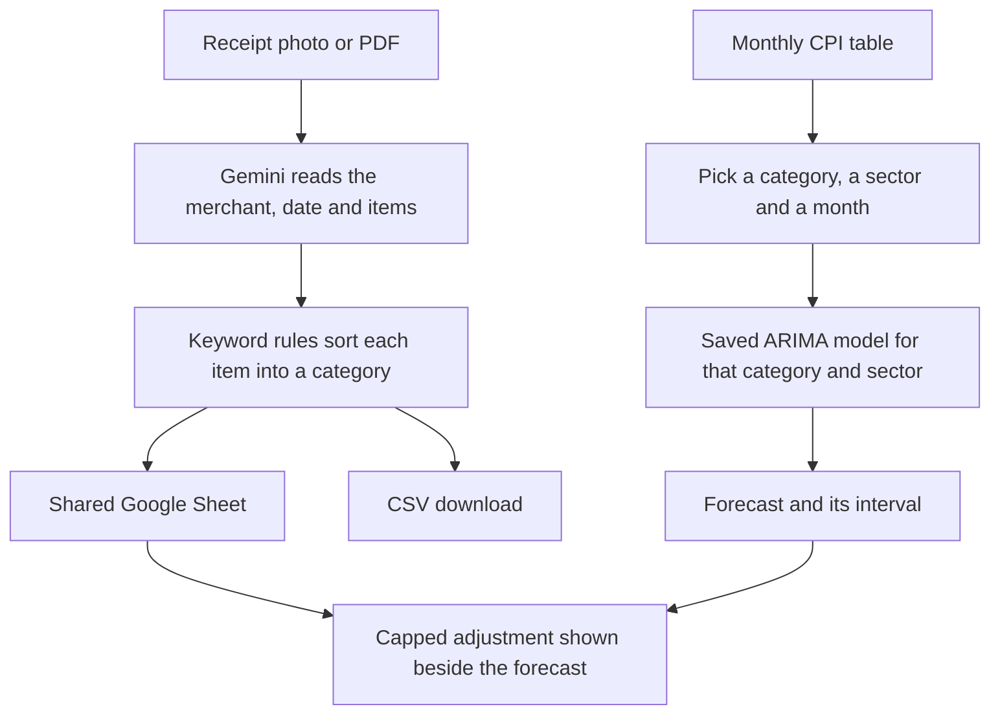

# Ayara

Ayara is a Streamlit app that forecasts Indian inflation for five spending categories with 15 ARIMA models and explains the trends for households and for government readers.

**Live app:** [ayara1.streamlit.app](https://ayara1.streamlit.app). If the app says it is asleep, click the wake button and give it a minute.

**White paper:** [docs/whitepaper.md](docs/whitepaper.md) covers the data, the models, the reported results and the limits.

Ayara began during my Data Scientist internship at Crimson Education (July to December 2025) and continued as an independent project afterward.

## How it works



- **Data.** A monthly Consumer Price Index table from January 2013 to July 2025 (base 2012 = 100). It covers five categories (Fuel and light, Fruits, Vegetables, Spices and Health), each as a rural, an urban and a combined series. It sits in `Resources/Revised Final Dataset.csv`.
- **Forecasts.** One saved statsmodels ARIMA model per category and sector, 15 in all, stored compressed in `Resources/Time Series Models/`. For a month inside the data, the app shows the recorded value. For a later month, it loads the matching model and shows the forecast as one value or as a chart with the model's interval.
- **Explanations.** The Analysis page has written analysis for each category, one version for government readers and one for households. Gemini can shorten it or translate it into Hindi or Telugu. Under each forecast, a button explains what the value means in everyday terms. That part runs in the app with no AI call. With a Gemini key set, a second button can add advice written by Gemini, using only the chart's numbers.
- **Receipts (optional).** Upload a receipt photo or PDF and Gemini reads the merchant, the date and each line item. Local keyword rules put every item in one of the five categories or in Other. The table can be downloaded as CSV or saved to a shared Google Sheet.
- **Community signal (experimental).** Receipts saved to the sheet feed a small, capped adjustment that the app shows beside the model's forecast, never in place of it. It only appears once a category has enough recent receipt items. The exact rule is in [section 4.2 of the white paper](docs/whitepaper.md#42-how-the-adjustment-is-calculated).

## Results

No accuracy table here yet. The white paper reports a twelve month holdout error for each of the 15 models ([section 3.2](docs/whitepaper.md#32-reported-model-results)). Those figures come from the original project paper and have not been rerun. A rerun next to a simple baseline comes next: a seasonal naive forecast, which predicts each month with the value from the same month a year earlier.

## Limits

- No baseline yet. The reported errors have not been compared with a simple seasonal forecast. Without that comparison they do not show how much the models add.
- The reported results are not reproduced here. This repo holds the app and the saved models, not the data preparation or the training code.
- Rural, urban and combined are national series. Ayara does not measure prices for a city, a district or a household. A local price index is future research.
- The receipt adjustment is an experiment. Its thresholds are design choices, not tested values. It has not been shown to improve forecasts.
- Gemini's receipt reading, translations, summaries and forecast advice can contain errors. Their accuracy has not been measured.
- The saved models were fit on data through July 2024. Before each forecast the app adds the twelve newer months (through July 2025) without changing the fitted settings. Forecasts start in August 2025.
- The 15 models are separate. Nothing keeps the rural, urban and combined forecasts consistent with each other. The models are not retrained automatically.

## Next steps

- Rerun the twelve month holdout for all 15 models next to the seasonal naive baseline and add the results table to this page.
- The longer research plan, including what a real local price index would need, is in [section 6 of the white paper](docs/whitepaper.md#6-research-direction-and-next-validation-work).

## Run it locally

Tested with Python 3.12. The pinned NumPy 1.26.4 has no wheels for Python 3.13.

```bash
git clone https://github.com/anandindukuri-hub/ayara_repository.git
cd ayara_repository
python3.12 -m venv .venv
.venv/bin/pip install -r requirements.txt
AYARA_RESOURCES_DIR="$PWD/Resources" .venv/bin/streamlit run ayara_app.py
```

On a Mac with an Intel build of Python, pip can fail to build cryptography. Adding `--only-binary=cryptography` to the install line fixes that.

`AYARA_RESOURCES_DIR` points the app at the `Resources/` folder in this repo. Without it the app looks in `~/Documents/Resources` first.

The charts, the forecasts and the explanations in English work with no keys. Receipt reading, translation and the optional forecast advice need a Gemini API key. Saving receipts needs a Google service account. [docs/DEPLOY.md](docs/DEPLOY.md) shows where both go and how to deploy on Streamlit Community Cloud.

## What is in this repo

- `ayara_app.py`: the whole app.
- `Resources/`: the CPI table, the 15 saved models and two images.
- `docs/whitepaper.md`: the public technical write up.
- `docs/DEPLOY.md`: the deploy and secrets guide.

## Data and credits

- CPI data: India's monthly Consumer Price Index (base 2012 = 100) from the National Statistical Office ([MOSPI](https://www.mospi.gov.in/)), accessed through the Reserve Bank of India's Database on Indian Economy ([DBIE](https://data.rbi.org.in/)).
- Built with Streamlit, pandas, statsmodels and matplotlib. Gemini reads receipts, translates text and writes the optional forecast advice. Google Sheets stores shared receipt rows.
- The source of `Resources/Inflation.jpg` is not recorded yet.

## License

[MIT](LICENSE) covers the code. The CPI data and the images in Resources/ stay under their owners' terms.
